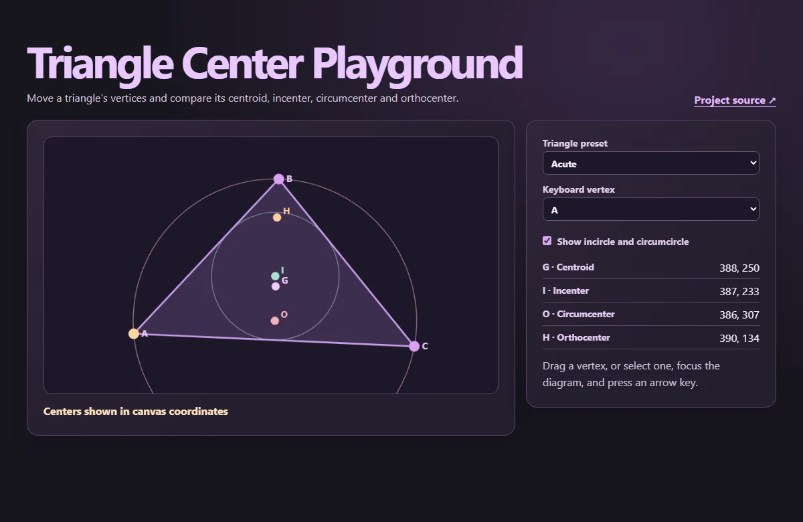

# Triangle Center Playground

Move a triangle's vertices and compare its centroid, incenter, circumcenter and orthocenter.

[Open the browser app](https://surfingcoder.com/apps/triangle-center-playground/)

## Run locally

Run the following command in this repository and open [localhost:8000](http://localhost:8000).

    python -m http.server 8000

The centroid averages the vertices. The incenter weights each vertex by the opposite side length. The circumcenter is equidistant from the vertices, and the orthocenter is where the altitudes meet. Centers outside the canvas are still reported numerically.

## Verify

Run the following command with Node.js 22 or newer.

    node --test
